# Кастомизация карточек MHA Bridge: галерея и справочник

Этот документ показывает, что и как можно настроить в карточках, и каждый пример снабжён скриншотом и конфигом. Все ключи можно писать прямо в YAML карточки; полный список с комментариями лежит в [`mha-card-full-config.yaml`](mha-card-full-config.yaml), краткая таблица — в [README](../README.md#-все-ключи-конфигурации).

> Скриншоты сделаны в тестовой странице с имитацией Home Assistant (данные демонстрационные), ширина телефона — 430 px, панели — 1920×1080. На вашем дашборде всё выглядит так же, но с живыми данными.

**Содержание**

1. [Какую карточку выбрать](#1-какую-карточку-выбрать)
2. [Вкладки: порядок, картинка, высота](#2-вкладки-порядок-картинка-высота)
3. [Панель на весь экран](#3-панель-на-весь-экран)
4. [Внешний вид машины](#4-внешний-вид-машины-вид-сбоку)
5. [Вид сверху (3D)](#5-вид-сверху-3d)
6. [Салон](#6-салон)
7. [Пресеты](#7-пресеты)
8. [Что показывать, а что скрыть](#8-что-показывать-а-что-скрыть)
9. [Топливо, шины, навигация](#9-топливо-шины-навигация)
10. [Цвет темы и размер текста](#10-цвет-темы-и-размер-текста)
11. [Язык](#11-язык)
12. [Готовые конфигурации](#12-готовые-конфигурации)
13. [Демо-режим](#13-демо-режим--demo)

---

> Все ключи ниже можно менять и без YAML: «Изменить» у карточки открывает визуальный редактор на штатных компонентах Home Assistant, пять вкладок: «Основное», «Вид» (в том числе цвета и салон), «Действия» (тапы, быстрые кнопки, скрытые блоки), «Пресеты», «Данные и карта» (вкладки карточки, навигация, топливо, шины). В конфиг попадают только изменённые ключи; YAML-режим остаётся, а все ключи YAML есть в форме (карта, размер текста по элементам, картинки вкладок, датчики капота и багажника, подписи вида сверху, эффекты салона, шаги пресета по сиденьям и окнам). Положение маркеров `car_image_hotspots` и `actions` пресета вводятся YAML-блоком прямо в форме.

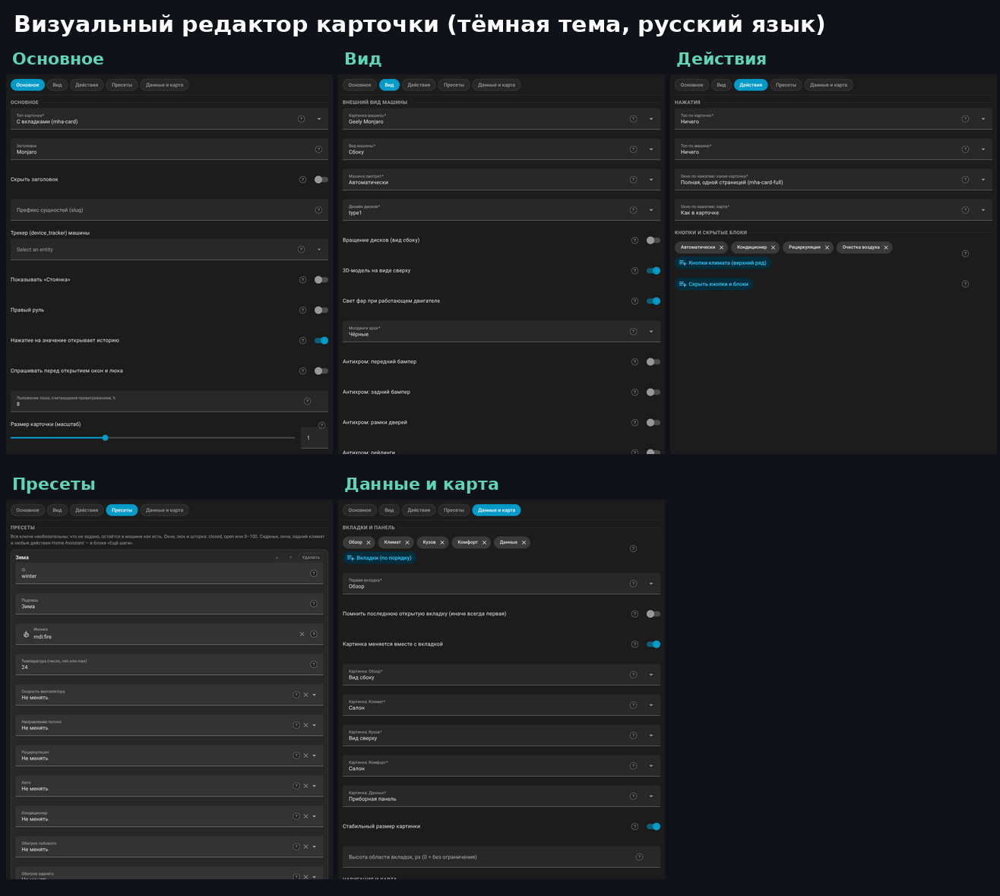

## 1. Какую карточку выбрать

Тип карточки задаётся ключом `type`. Видов пять, а машину можно показать сбоку или сверху ключом `view`.

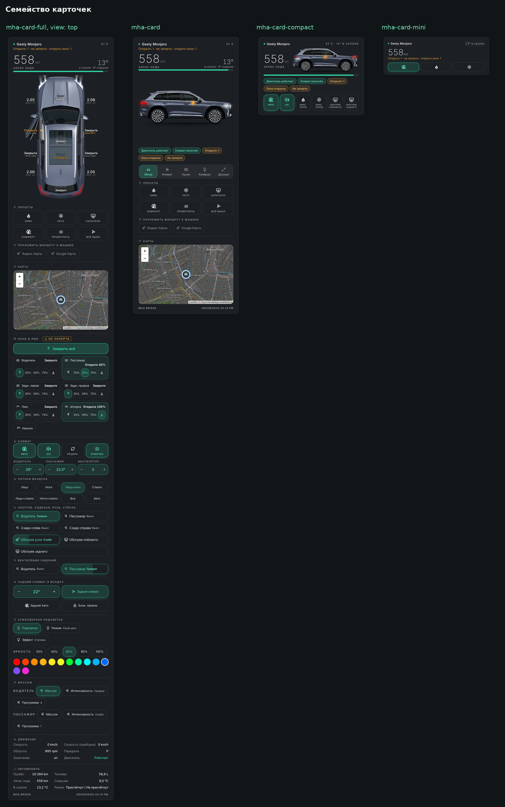

| Тип карточки | Для чего |
|---|---|
| `custom:mha-card` | Пять вкладок: Обзор, Климат, Кузов, Комфорт, Данные. **Основная карточка, лучший выбор и для телефона, и для широкого экрана** |
| `custom:mha-card-full` | Всё на одной длинной странице: дальше всего листать, зато ничего не прячется |
| `custom:mha-card-compact` | Узкая карточка: запас хода, температура и ряд кнопок (`buttons`) |
| `custom:mha-card-mini` | Одна строка: статус и пара кнопок. Для верхней части дашборда |
| `custom:mha-card-panel` | Вкладки, масштабированные на весь экран (1920×1080): для настенного планшета или ноутбука |

Ключ `view` (у `mha-card`, `mha-card-full` и `mha-card-panel`): `side` (по умолчанию) — фото сбоку, `top` — 3D-вид сверху с открытыми дверями, окнами, люком, капотом и багажником; на вкладке «Обзор» вместо шин показываются данные автомобиля, потому что давление уже на рисунке.

```yaml
type: custom:mha-card
view: top
```

## 2. Вкладки: порядок, картинка, высота

В `mha-card` и `mha-card-panel` порядок сверху вниз всегда один: **вкладки → пресеты → ссылки «проложить маршрут» → карта (если включена) → остальное**. Шины лежат внизу вкладки «Данные». Кнопки климата (по умолчанию шесть; набор верхнего ряда задаётся ключом `climate_buttons`, «Макс. тепло» и «Макс. холод» скрыты и включаются там же) живут на вкладке «Климат».

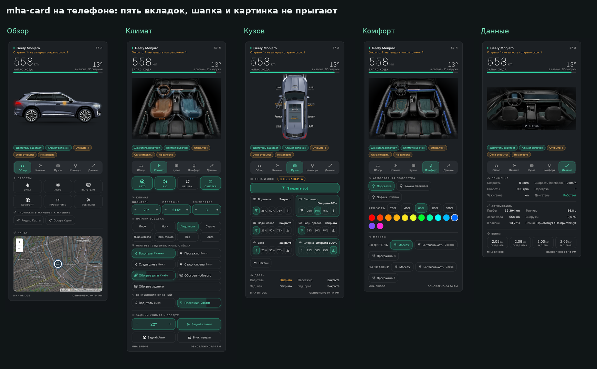

Шапка, картинка и полоса вкладок стоят на месте при переключении (картинка лежит в «сцене» фиксированной формы). Меняется только содержимое ниже, поэтому кнопки не прыгают. Это можно отключить ключом `stable_tabs: false` (см. ниже).

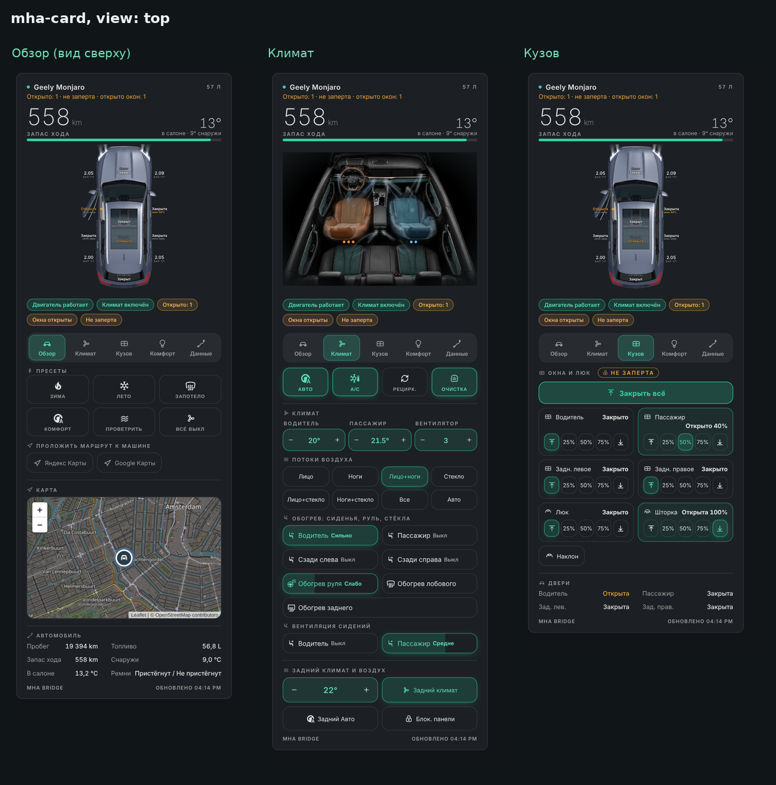

```yaml
type: custom:mha-card
tabs: [overview, climate, body, comfort, data]   # какие вкладки и в каком порядке
default_tab: overview                            # вкладка при открытии (всегда)
remember_tab: false                              # true: помнить последнюю выбранную вкладку в браузере
```

### Выравнивание при смене вкладок — `stable_tabs`

По умолчанию (`stable_tabs: true`) картинка стоит в «сцене» одной формы, и всё под ней остаётся на месте. С `stable_tabs: false` каждая картинка занимает свою высоту: карточка компактнее, но контент ниже сдвигается при смене вкладки.

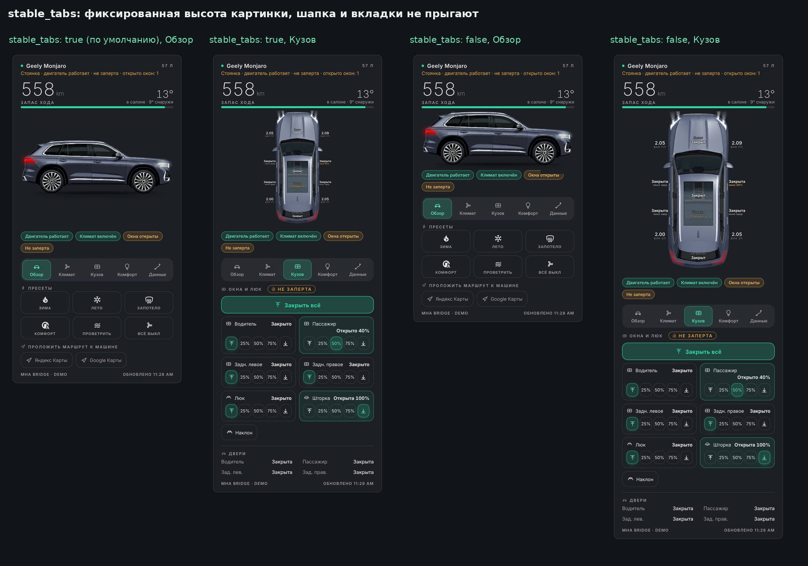

```yaml
stable_tabs: false
```

Вкладка «Комфорт» (задний климат, подсветка, массаж) пропадает сама, если в машине нет этих функций. Можно оставить только нужные вкладки: `tabs: [overview, climate]`.

### Картинка над вкладками — `tab_images`

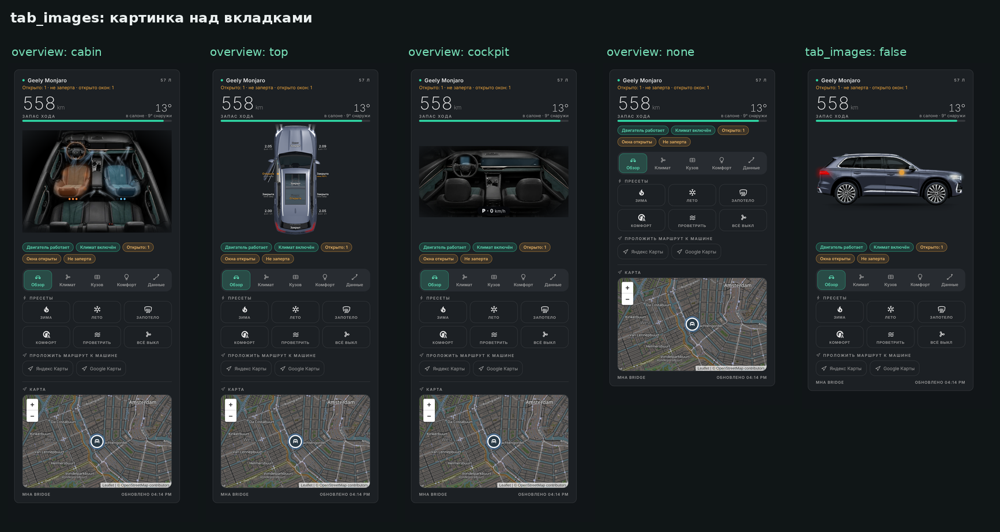

По умолчанию картинка меняется вместе с вкладкой: «Обзор» — фото сбоку (при `view: top` — вид сверху), «Климат» — салон сверху, «Кузов» — 3D сверху, «Комфорт» — салон, «Данные» — приборная панель. Свой вариант для каждой вкладки:

```yaml
tab_images:
  overview: cabin      # side | top | cabin | cockpit | none
  climate: cabin
  body: top
# tab_images: false    # одна и та же картинка на всех вкладках
```

### Широкий экран

На широком экране вкладки получают фиксированную высоту области (`height`, по умолчанию 440 px, `0` — без ограничения), содержимое прокручивается внутри.

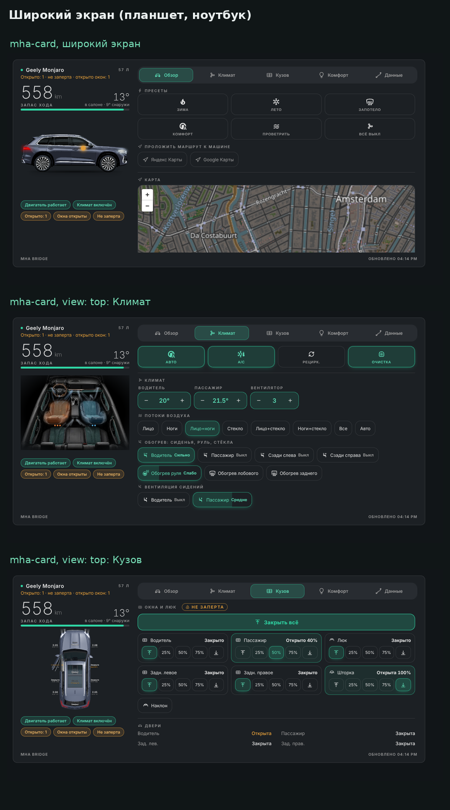

## 3. Панель на весь экран

`custom:mha-card-panel` рассчитана на экран целиком: крупная цифра запаса хода, большая картинка слева, крупные вкладки и кнопки по центру, карта справа (если включена). Масштаб подбирается сам; ставьте её в вид типа **Panel (одна карточка)**.

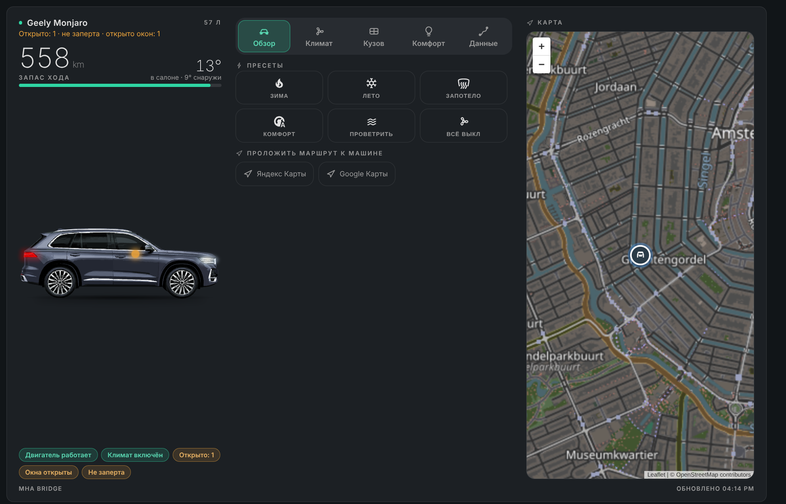

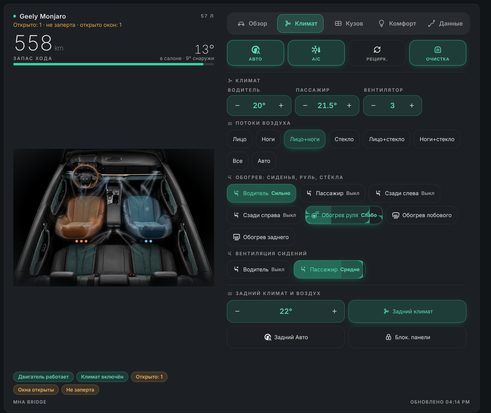

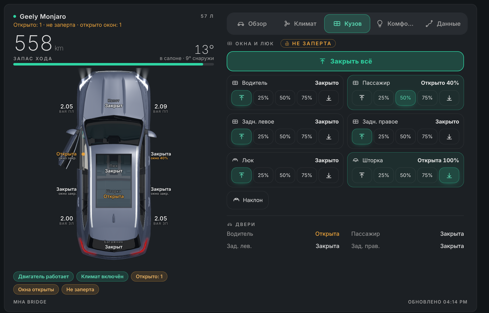

### Три колонки: машина, управление, карта

Если включить карту (`map: true`), панель раскладывается на три колонки: **слева машина** (картинка, запас хода, чипы), **по центру вкладки и кнопки**, **справа карта на всю высоту (около трети экрана)**. Карта видна на всех вкладках, а из вкладки «Обзор» уходит. Без `map` колонок две, как раньше.

Размеры. Панель рисуется на «холсте» 1280×640 CSS-пикселей (две колонки: 1040×640) и масштабируется под экран от 0.6 до 2.6. Отсюда минимум для трёх колонок: **768×384 CSS-пикселей** (1280×0.6 и 640×0.6). Ноутбук 1366×768 даёт масштаб около 1.0, планшет 1024×600 около 0.8, телефон в альбомной ориентации 844×390 около 0.6 (текст мелкий, но читается). Меньше минимума (узкая колонка на компьютере) карточка ведёт себя как `mha-card`.

Смартфон в портрете. По умолчанию (`rotate: off`), если открыть страницу с панелью на телефоне, который держат вертикально, или в узкой колонке, панель становится карточкой с вкладками (портретная раскладка; карта идёт на вкладке `map.tab`). `rotate: auto` вместо этого разворачивает холст на 90° на весь экран: достаточно повернуть телефон по часовой стрелке. `rotate: always` включает разворот и вне сенсорных экранов.

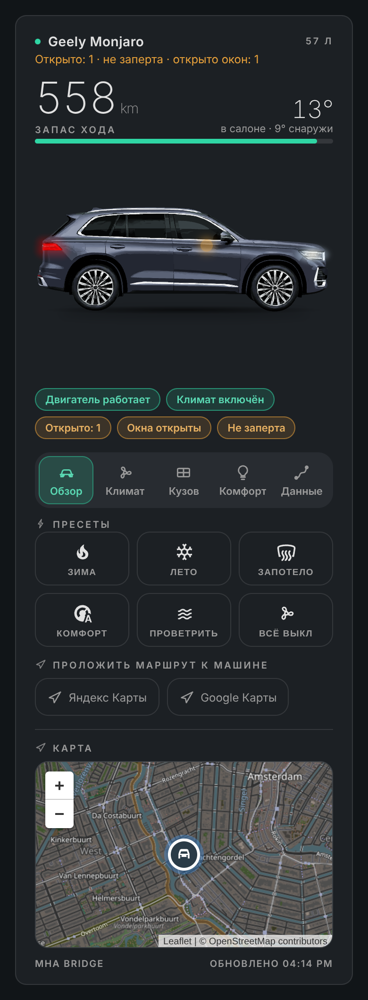

С `rotate: auto` вместо этого вся панель разворачивается на бок, а телефон нужно повернуть:

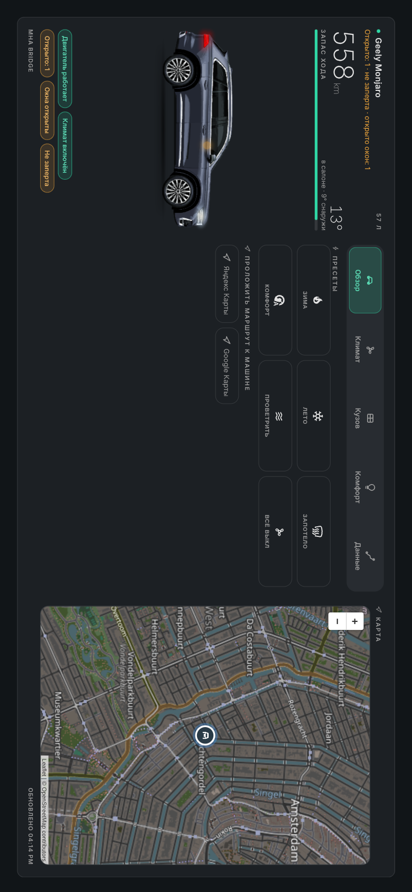

```yaml
type: custom:mha-card-panel
map: true           # карта в правой трети
rotate: off         # off (по умолчанию) | auto | always
panel_min_width: 900   # уже 900 px — карточка с вкладками (портретная раскладка); без ключа — по месту под колонки
zoom: 0.85          # подгонка автоматического масштаба: меньше 1 — карточка мельче, больше места, нет прокрутки
scale: 1.6          # или абсолютный масштаб (от 0.5); по умолчанию подбирается по размеру окна
panel_height: 1000  # высота в пикселях; по умолчанию — остаток окна
```

Если справа появилась полоса прокрутки (не помещается длинная вкладка, например «Кузов»), поставьте `zoom: 0.9`, `0.85` или меньше. Ключ `zoom` работает и в остальных карточках (`0.5`–`2`): `mha-card`, `mha-card-full`, `-compact` и так далее.

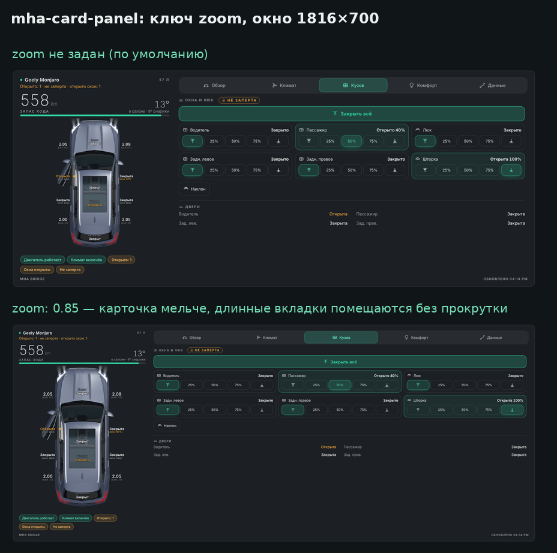

На узком экране панель ведёт себя как обычная `mha-card`.

## 4. Внешний вид машины (вид сбоку)

Картинка машины — векторная, поэтому перекрашивается без потери качества. Меняются только краска кузова, хромированные молдинги, молдинги арок и диски; стёкла, шины и фары остаются на месте.

### Цвет кузова — `car_color`

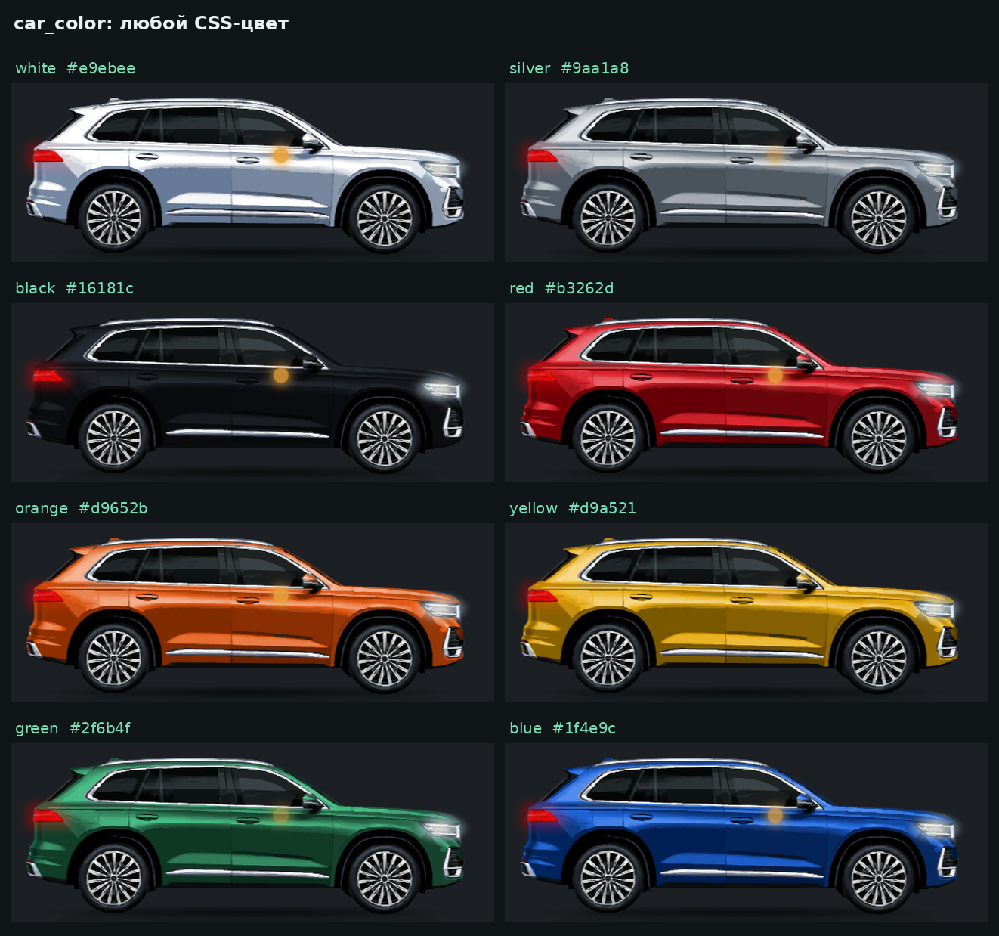

```yaml
car_color: "#b3262d"    # любой CSS-цвет: #rrggbb, rgb(...), название
```

Тот же цвет применяется к крыше на виде сверху и к 3D-модели.

### Диски — `wheels`

Один ключ меняет оба колеса сразу. `type1` — родные диски (как на исходной картинке), `type2`…`type5` — другие диски Monjaro.

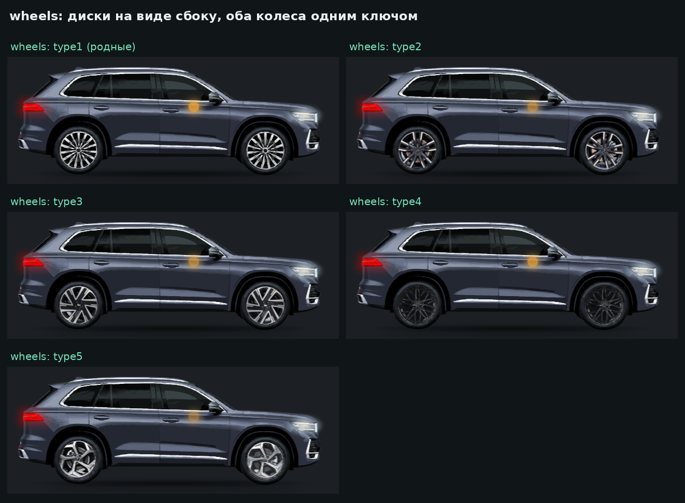

```yaml
wheels: type3    # type1 (по умолчанию) | type2 | type3 | type4 | type5
```

Диски работают вместе со всеми остальными настройками вида (цвет, антихром, арки, зеркалирование).

#### Вращение дисков — `wheel_spin`

```yaml
wheel_spin: true              # диски на виде сбоку крутятся вместе с машиной (по умолчанию выключено)
wheel_circumference: 2.29     # длина окружности качения, м (по умолчанию колесо 20", ≈ 2,29 м)
wheel_spin_entity: sensor.my_speed   # необязательно: любой датчик скорости вместо штатного
```

Скорость вращения считается из скорости машины (`speed_ipk`, иначе `speed`; км/ч, миль/ч и м/с распознаются) и длины окружности колеса, то есть примерно совпадает с настоящей. На задней передаче диски крутятся в обратную сторону, на стоянке стоят. Когда спицы уже не различить глазом (быстрее ≈ 25 км/ч), они плавно переходят в размытый диск, как на фото с выдержкой. Работает со встроенной картинкой Monjaro и со всеми дизайнами `wheels`; при включённом в системе «уменьшении движения» не анимируется.

### Антихром — `chrome_delete`

Хромированные детали можно затемнить, покрасить в цвет кузова или в любой другой цвет. Пять независимых зон: `front_bumper`, `rear_bumper`, `doors` (рамки дверей), `rails` (рейлинги), `windows` (молдинги стёкол).

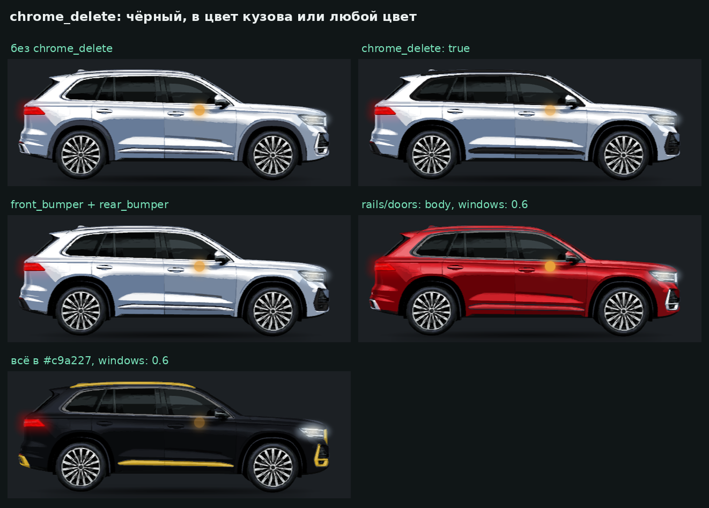

```yaml
chrome_delete: true                  # все пять зон в глянцевый чёрный

chrome_delete:                       # или по зонам
  front_bumper: 1                    # 0..1 — степень затемнения (1 = чёрный)
  rear_bumper: 1
  doors: "body"                      # "body" — в цвет кузова
  rails: "#c9a227"                   # любой цвет, блики сохраняются
  windows: 0.6
```

### Молдинги арок — `arch_color`

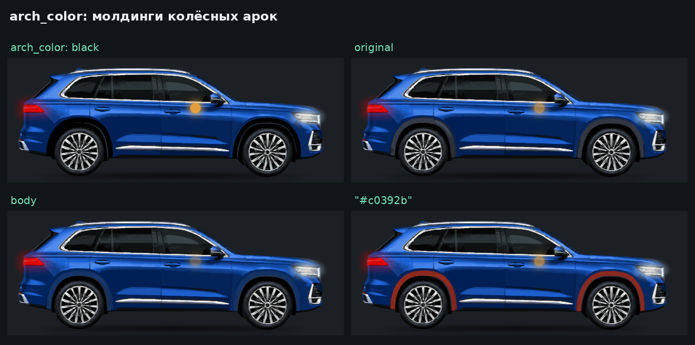

```yaml
arch_color: black       # black (по умолчанию) | original | body | любой цвет
```

`original` оставляет цвета исходной фотографии (`car_color` на арки тогда не действует).

### Направление машины — `car_image_facing`

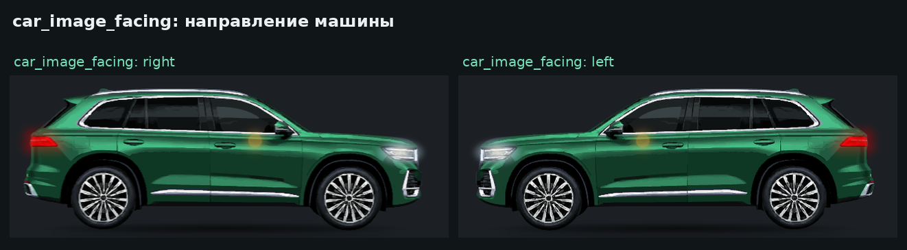

```yaml
car_image_facing: left   # right (по умолчанию) | left
```

Зеркалится и сама картинка, и маркеры (фары, ручки, капот, багажник). Положение маркеров можно поправить в `car_image_hotspots` (проценты от рамки картинки).

### Своя картинка — `car_image`

```yaml
car_image: monjaro                       # встроенная машина (по умолчанию)
# car_image: drawing                     # нарисованный силуэт
# car_image: /local/my-car.png           # своё фото сбоку (PNG/WebP/SVG)
car_image_facing: left                   # куда смотрит машина на вашем фото
# car_image_flip: true                   # отразить картинку по горизонтали
# car_image_top: /local/my-car-top.png   # своя картинка для вида сверху (если 3D выключен)
car_image_hotspots:
  headlight: [93, 45]
  taillight: [5, 38]
```

## 5. Вид сверху (3D)

С `view: top` машина показана сверху как 3D-модель: двери распахиваются, окна и люк показывают положение в процентах, капот и багажник открываются. Подписи (давление в шинах, состояние дверей и окон) можно включать по группам.

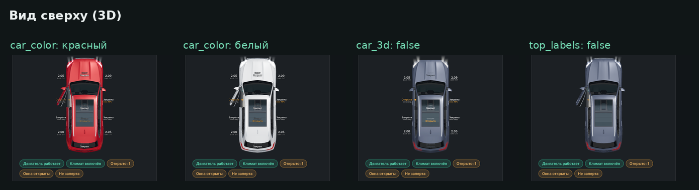

```yaml
car_3d: true                  # false — плоская картинка вместо 3D (если WebGL недоступен)
rhd: false                    # true — правый руль: стороны меняются местами
# Каждая подпись кликабельна: двери, окна, люк, шторка, капот, багажник и шины открывают историю своей
# сущности. Выключить клики: more_info: false. Люк и шторка — отдельные подписи (люк над передней
# половиной крыши, шторка над задней). Скрыть обе: top_labels: { roof: false }.
top_labels:                   # какие подписи показывать
  doors: true
  windows: true
  roof: true
  trunk: true
  hood: true
  tires: true
# top_labels: [doors, windows]   # или списком только нужных
# top_labels: false              # убрать все подписи сразу
```

Капот и багажник подхватываются автоматически, если в Home Assistant есть сущности «Капот» и «Багажник». Подписи люка, шторки, капота и багажника показываются всегда; единое правило для всех значений карточки: неизвестное или неполученное состояние отображается как «—», а не как «Закрыта» или 0. «—» значит, что состояние ещё ни разу не приходило от машины; последнее известное состояние запоминается и после перезапуска HA.

Люк, который лишь приподнят сзади для проветривания, подписывается «Проветр.» вместо процента. Граница задаётся ключом `sunroof_vent_max` (в процентах, по умолчанию `8`): всё, что открыто не больше этого значения, считается проветриванием.

```yaml
sunroof_vent_max: 8     # люк открыт не больше 8 % — подпись «Проветр.»
```

### Свет фар — `headlights`

Пока двигатель работает, передние и задние фары светятся: на виде сбоку, на виде сверху и в 3D. Нужна сущность «Двигатель работает» (`engine_running`).

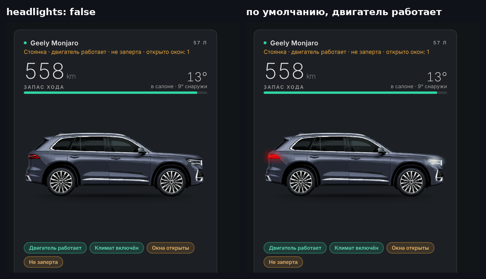

Вид сверху в 3D:

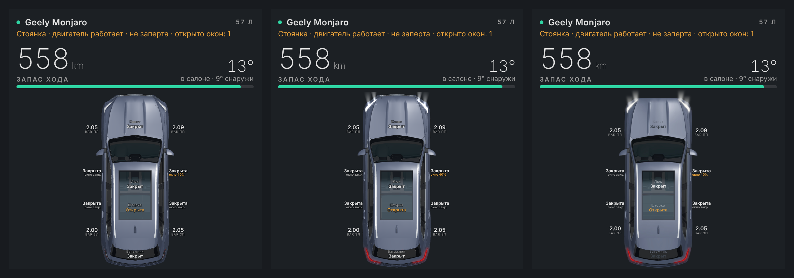

```yaml
headlights: false             # true по умолчанию; false — не подсвечивать
```


## 6. Салон

Фото салона сверху на вкладке «Климат» показывает подогрев и вентиляцию сидений, подогрев руля, потоки воздуха из дефлекторов и обогрев стекла. Ткань сидений и декор перекрашиваются.

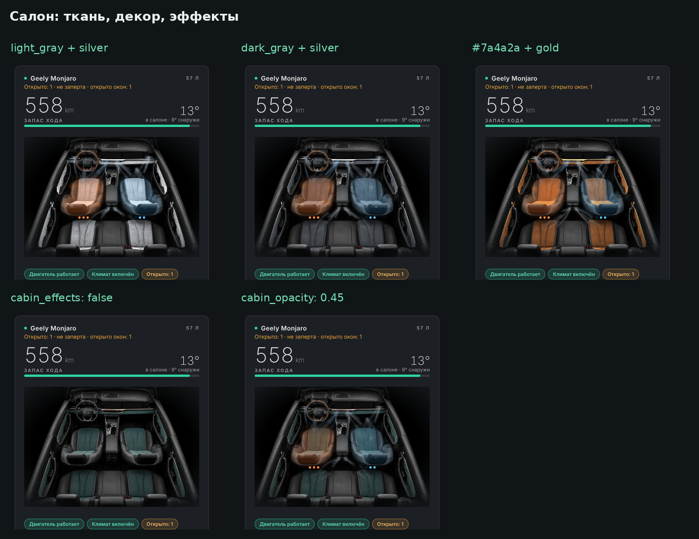

```yaml
cabin_fabric: dark_gray      # green (по умолчанию) | light_gray | dark_gray | любой цвет
cabin_trim: silver           # bronze (по умолчанию) | silver | gold | любой цвет
cabin_effects: [heat, vent, air]   # что рисовать: false, список или карта; доступны heat, vent, wheel, air, defrost, ambient, massage
cabin_opacity: 0.6           # по умолчанию 0.6; прозрачность эффектов 0..1 или карта { heat: 0.8, vent: 0.5, air: 0.4 }
```

## 7. Пресеты

Пресеты — до 8 плиток одной кнопки под картинкой. Всё, что делает пресет, записано в YAML карточки: климат, окна, люк, шторка и любые сервисы Home Assistant. Иконка — любая из Material Design Icons (`mdi:название`). Подробный справочник со всеми ключами: [README, раздел «Пресеты»](../README.md).

Плитки раскладываются сами: до 4 штук — один ряд, 5–6 — по три в ряд, 7–8 — по четыре.

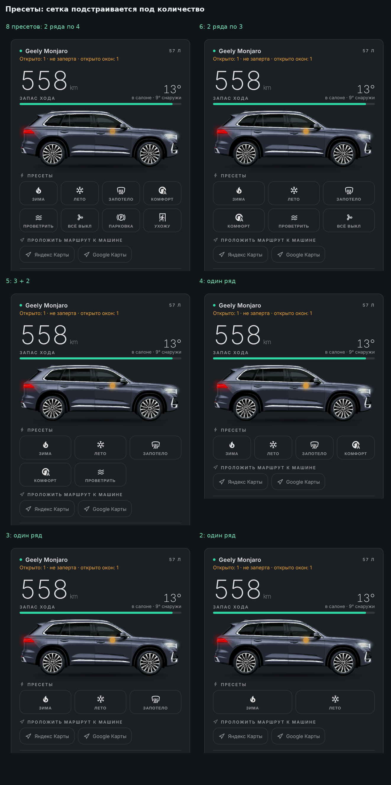

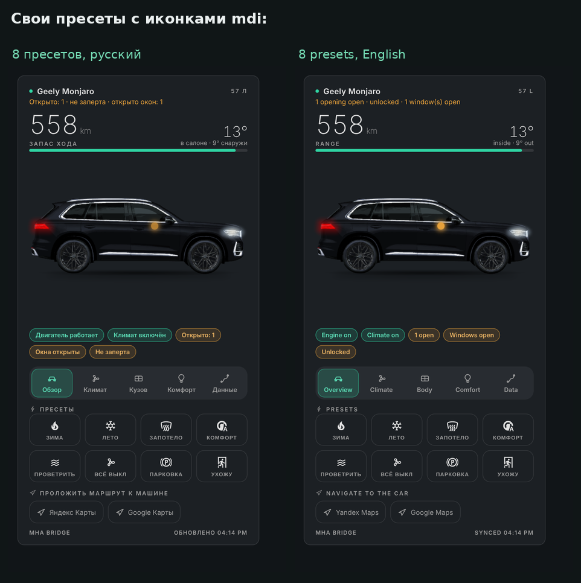

```yaml
presets:
  - id: comfort
    name: Комфорт
    icon: auto
    temp: 22
    auto: true
    ac: true
    circ: auto
  - id: parking
    name: Парковка
    icon: mdi:car-brake-parking
    windows: closed
    sunroof: closed
    sunshade: closed
    ac: false
  - id: leave
    name: Ухожу
    icon: mdi:exit-run
    windows: closed
    actions:                       # любые сервисы Home Assistant
      - action: light.turn_off
        target: { entity_id: light.garage }
```

В коде встроенных пресетов нет: если пресета нет в списке, его нет и на карточке. Шесть привычных («Зима», «Лето», «Запотело», «Комфорт», «Проветрить», «Всё выкл») со всеми шагами лежат в [`examples/presets.yaml`](../examples/presets.yaml): скопируйте блок в конфиг и правьте.

### Тап по карточке и по машине — `tap_action`, `car_tap_action`

Что происходит при тапе по самой карточке (`tap_action`) и по картинке машины (`car_tap_action`). Работает на любой карточке; кнопки, давления шин и вкладки по-прежнему делают своё: тап по давлению колеса открывает полную историю датчика.

```yaml
car_tap_action: expand          # по умолчанию на компактной карточке: окно с полной карточкой
tap_action: none                # по умолчанию: ничего
```

Значения: `expand` (окно с полной карточкой), `none`, либо действие как в Home Assistant:

```yaml
# переход на другую страницу Lovelace, например с карточкой-панелью
car_tap_action:
  action: navigate
  navigation_path: /lovelace/car-panel

# открыть ссылку в новой вкладке
tap_action:
  action: url
  url_path: https://example.com

# история любого датчика
tap_action:
  action: more-info
  entity: sensor.my_sensor

# вызвать действие
tap_action:
  action: perform-action
  perform_action: script.turn_on
  data: { entity_id: script.warm_up }
```

Можно писать и коротко: `tap_action: expand`, `car_tap_action: none`. На мини-карточке (`mha-card-mini`) картинки машины нет: там работает `tap_action` (например `tap_action: expand`, чтобы она тоже открывала полную карточку). Внутри открытого окна эти ключи не действуют.

### Окно по нажатию — `popup_card`, `popup_map`

При `expand` открывается окно с карточкой. Какая именно карточка и есть ли в ней карта, задают два ключа:

```yaml
popup_card: mha-card-full   # mha-card-full (по умолчанию) | mha-card | mha-card-compact | mha-card-mini
popup_map: true             # true — в окне всегда карта; false — без карты; без ключа — как в карточке
```

Карта в окне берёт настройки из `map` самой карточки (трекер, масштаб, маркер); если на дашборде карты нет, `popup_map: true` включает её с настройками по умолчанию. Тапы внутри окна ничего не делают.

## 8. Что показывать, а что скрыть

Ключ `hide` убирает кнопки и блоки, которые вам не нужны. Это удобно, если в машине нет какой-то функции или вы просто ею не пользуетесь.

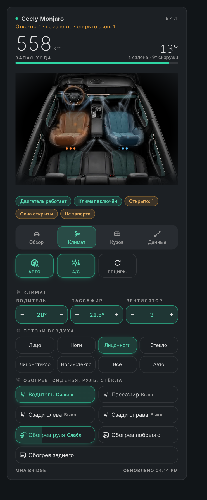

```yaml
hide:
  - seat_cooling     # вентиляция сидений
  - rear_climate     # задний климат
  - gclean           # очистка воздуха
  - ambient          # подсветка
  - massage          # массаж
  - maxheat          # кнопка «Макс. тепло»
  - maxcool          # кнопка «Макс. холод»
```

Допустимые значения: `auto`, `ac`, `defrost`, `rear`, `recirc`, `wheel`, `maxheat`, `maxcool`, `seat_heating`, `seat_cooling`, `windows`, `lock`, `rear_climate`, `gclean`, `ambient`, `massage`.

#### Кнопки климата: `climate_buttons`

Верхний ряд вкладки «Климат» по умолчанию содержит четыре кнопки: **Авто**, **Кондиционер**, **Рециркуляция** и **Очистка воздуха**. Каждая показывает реальное состояние функции. «Макс. тепло» и «Макс. холод» по умолчанию скрыты; чтобы вернуть их или убрать лишние, задайте список (порядок кнопок всегда один и тот же):

```yaml
climate_buttons: [auto, ac, recirc, gclean, maxheat, maxcool]   # по умолчанию [auto, ac, recirc, gclean]
```

Обогрев руля, лобового и заднего стекла в этот ряд не входит: они находятся в разделе **«Обогрев: сиденья, руль, стёкла»** рядом с подогревом сидений (скрываются значениями `wheel`, `defrost`, `rear` ключа `hide`). Плитки пресетов никогда не подсвечиваются: это разовое действие, а не переключатель.

Заголовок: `name: "Моя Monjaro"` меняет имя, `hide_name: true` убирает его. `show_parked: true` показывает метку «Стоянка», когда машина стоит. Сущности ищутся автоматически; если у машины нестандартный префикс, задайте `prefix: geely_monjaro`. Если значение на карточке не появляется, добавьте `debug: true`: под карточкой будет написано, какая сущность найдена для каждого ключа и в каком она состоянии.

## 9. Топливо, шины, навигация


```yaml
tank_size: 60                 # объём бака, л (для пересчёта процентов в литры)
fuel_warn: 25                 # жёлтая ступень, %
fuel_critical: 10             # красная ступень, %
fuel_color_ok: "#2fd6a4"
fuel_color_warn: "#e8a13a"
fuel_color_critical: "#e5484d"
tire_critical: 1.8            # давление ниже этого значения красное
tire_color_critical: "#e5484d" # цвет критического давления
nav: [yandex, maps, osm]      # кнопки навигаторов: yandex, maps, osm, apple, here
nav_mode: route               # route — проложить маршрут к машине, locate — показать машину на карте
nav_travel: walking           # driving | walking | transit | bicycling
tracker: device_tracker.geely_monjaro   # трекер машины в HA (GPS), нужен для кнопок навигации
confirm_open: true            # спрашивать подтверждение перед открытием окон и люка
more_info: true               # клик по значению открывает историю HA
```

### Карта — `map`

Карту можно встроить прямо в карточку. Это штатная карта Home Assistant, но без своей рамки и тени: она оформлена как остальные блоки, масштабируется колесом и кнопками, двигается пальцем или мышью. По умолчанию выключена. Показывается на вкладке «Обзор» (в `mha-card` и `mha-card-full` — после ссылок маршрута).

```yaml
map: true                         # включить с настройками по умолчанию
# или подробно:
map:
  entity: device_tracker.geely_monjaro   # трекер (по умолчанию ключ tracker карточки)
  zoom: 15                        # масштаб по умолчанию, 1–22
  aspect_ratio: "16:10"           # пропорции; вместо них можно задать height: 260 (px)
  theme_mode: auto                # auto | light | dark
  hours_to_show: 0                # сколько часов показывать след пути (0 — не показывать; если задан trail_color или trail_width, по умолчанию 24)
  tab: overview                   # на какой вкладке: overview, climate, body, comfort, data
  title: Где машина               # заголовок над картой; "" — без заголовка
  center: auto                    # auto (как в HA) | follow (всегда держать машину в центре) | fixed (не двигать при обновлениях)
  locate_button: false            # true — кнопка «К машине» поверх карты
  marker: car                     # car (Monjaro сверху цвета машины, по умолчанию) | default (штатный маркер HA) | адрес картинки: /local/marker.png
  marker_size: 56                 # высота маркера, px (16–160)
  marker_rotate: true             # поворачивать маркер по курсу (атрибут heading, course или bearing у трекера)
  marker_heading: course          # имя атрибута курса, если оно другое
  caption: [speed, state]         # подпись под своим маркером: speed, state, address, name
  address_entity: sensor.car_address   # откуда брать адрес (иначе атрибут address у трекера)
  label: icon                     # подпись штатного маркера: icon | name | state | attribute
  label_attribute: speed          # какой атрибут показывать при label: attribute
  label_unit: km/h
  entities:                       # ещё объекты на карте: зоны, вторая машина, люди
    - zone.home
    - entity: device_tracker.wife
      label_mode: name            # name | state | attribute | icon
      focus: false                # не учитывать при подборе масштаба
  geo_location_sources: []        # источники geo_location, например [all]
  auto_fit: false                 # подобрать масштаб так, чтобы вошли все объекты
  fit_zones: false                # учитывать зоны при подборе
  trail_color: "#ff3b7a"          # цвет следа пути (любой цвет CSS; можно без #: ff3b7a)
  trail_width: 4                  # толщина линии следа
```

**Свой маркер.** По умолчанию (`marker: car`) поверх карты рисуется маленькая Monjaro сверху цвета `car_color` (без `car_color` — цвета по умолчанию); штатный маркер этого трекера прячется. Вернуть штатный маркер: `marker: default`; своя картинка: `marker: /local/marker.png`. Маркер поворачивается по курсу, если у трекера есть атрибут `heading`, `course` или `bearing`; нажатие на него открывает историю трекера. Подпись `caption` собирается из скорости (сенсор скорости карточки), состояния трекера, названия и адреса (сенсор `address_entity` или атрибут `address` трекера). При `marker: default` работает штатный маркер Home Assistant: его картинка берётся из `entity_picture` трекера, а подпись выбирается ключом `label`.

**Центр карты.** `center: follow` сдвигает карту за машиной при каждом новом положении, `center: fixed` один раз ставит машину в центр и больше ничего не двигает (карту можно листать вручную, подбор масштаба отключён). Кнопка `locate_button` возвращает карту к машине. `entities` добавляет на карту зоны, вторую машину и людей, `auto_fit` подбирает масштаб так, чтобы вошли все объекты. Цвет и толщина следа (`trail_color`, `trail_width`) действуют на след, который включается `hours_to_show`.

Если у трекера нет координат, блок не показывается. Карта строится штатной карточкой `map`, поэтому плитки, тема и точка машины берутся из вашего Home Assistant.

На превью фоном служит фрагмент карты OpenStreetMap, © участники OpenStreetMap (ODbL). В вашей карточке плитки рисует Home Assistant; кнопки масштаба и положение точки на снимках не интерактивны.

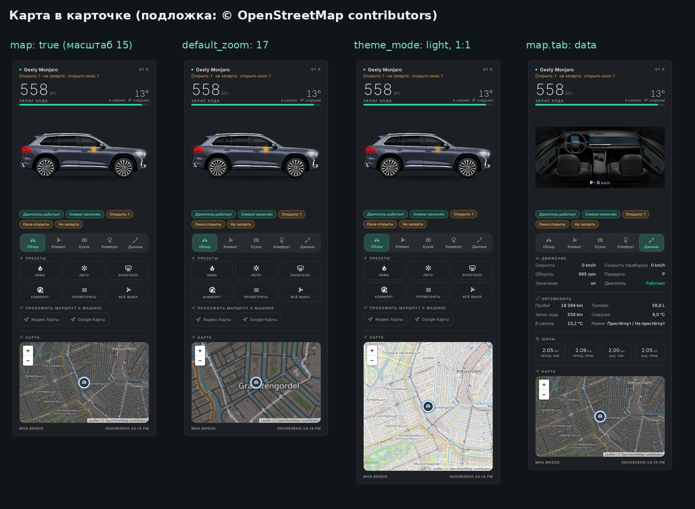

### Окна и люк на вкладке «Кузов»

Плитки окон стоят как места в машине: заднее левое всегда под водительским, заднее правое под пассажирским. Люк и шторка встают третьим столбцом, а если ширины не хватает (телефон), уходят вниз отдельным рядом. Больше трёх столбцов не бывает, плитки растягиваются на всю ширину.


## 10. Цвет темы и размер текста

### Цвет темы — `accent`

Основной цвет карточки (по умолчанию зелёный): полоса запаса хода, точка у названия, активные кнопки и вкладки, чипы, рамки включённых переключателей. Значение — имя из списка или любой CSS-цвет.

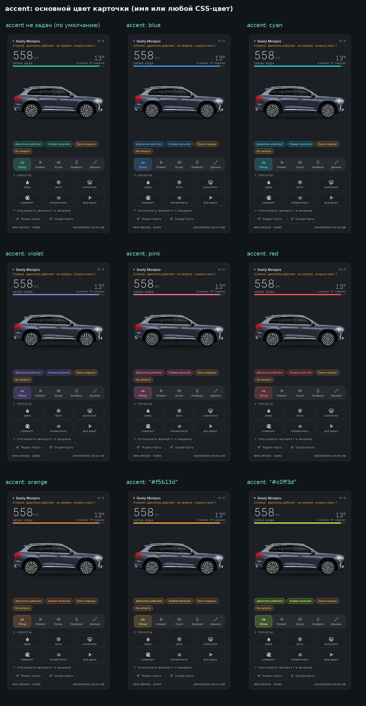

```yaml
type: custom:mha-card
accent: orange            # green (по умолчанию), mint, blue, sky, cyan, violet, purple,
                          # pink, red, orange, amber, yellow, lime, white
# accent: "#c0ff3d"       # или любой CSS-цвет: "rgb(255 140 0)", "hsl(200 90% 55%)"
warn_color: "#e8a13a"     # необязательно: цвет предупреждений (по умолчанию янтарный)
critical_color: "#e5484d" # необязательно: цвет критичных значений (давление шин и т.п., по умолчанию красный)
```

Ключ работает во всех карточках. Цвета тёплого и холодного потока воздуха на картинке салона и цвет кузова не меняются — они показывают температуру и выбираются отдельно (`car_color`).

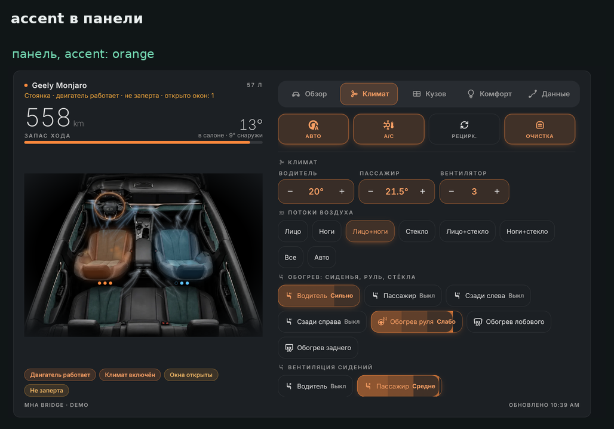

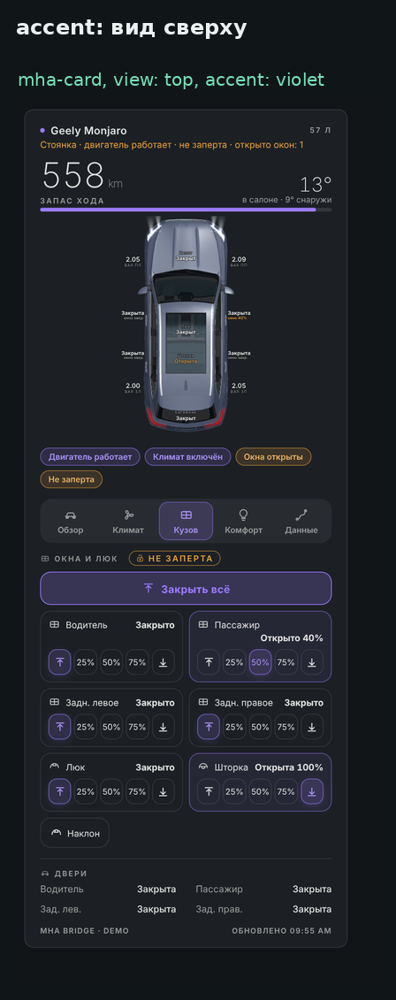

### Размер текста — `text_size`

Размер текста можно менять целиком или по типам элементов. Значение — число: до 4 включительно это множитель (`1.2` — на 20 % крупнее, `0.85` — мельче), больше 4 — точный размер в пикселях; можно писать и строкой: `"14px"`, `"120%"`.

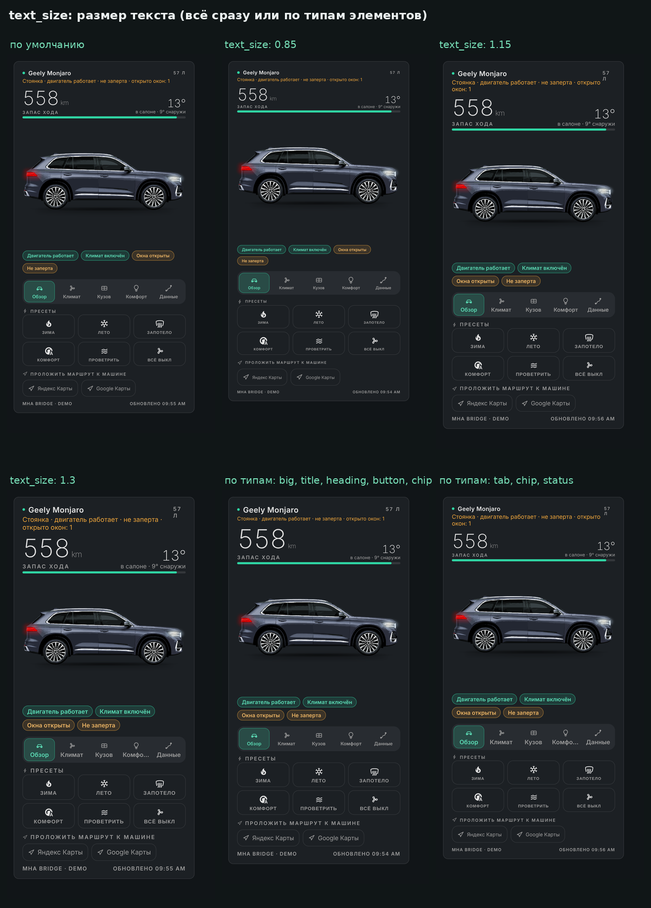

```yaml
text_size: 1.15           # всё сразу на 15 % крупнее
```

```yaml
text_size:                # или по типам элементов (каждый ключ необязателен)
  all: 1.1                # всё, у чего нет своего ключа
  title: 1.3              # название машины
  status: 1.15            # строка статуса под названием
  big: 1.35               # большая цифра запаса хода (и температура в компактной карточке)
  side: 1.2               # цифры справа от неё
  unit: 1.2               # единицы измерения (km, °C)
  heading: 12px           # заголовки блоков (КЛИМАТ, ШИНЫ, ...)
  button: 1.2             # подписи на кнопках и плитках (пресеты, климат, сиденья)
  chip: 1.15              # чипы «Двигатель работает», «Не заперта»
  tab: 1.3                # названия вкладок
  row: 1.1                # строки данных (пробег, топливо, двери)
  stepper: 1.2            # значения температуры и вентилятора между − и +
  window: 1.1             # плитки окон, люка и шторки
  tire: 1.2               # давление в шинах
  caption: 1.1            # подписи на фото салона
  label3d: 1.2            # подписи на виде сверху (только множитель)
```

- Размер считается от того, какой он у элемента сейчас, поэтому работает на любой ширине и в любой карточке.
- Крупный текст занимает больше места: длинные подписи могут сократиться («Комфо…»), а высокие вкладки — потребовать прокрутки. Если не помещается, уменьшайте `zoom` или сам `text_size`.
- Для подписей на виде сверху (`label3d`) пишите только множитель: они нарисованы внутри картинки и не измеряются в пикселях экрана.
- Ключ `zoom` меняет размер всей карточки целиком (`0.5`–`2`); `text_size` — только текст.

## 11. Язык

Интерфейс карточки русский или английский, язык берётся из профиля пользователя Home Assistant. Названия пресетов и подписи переключаются вместе с ним.

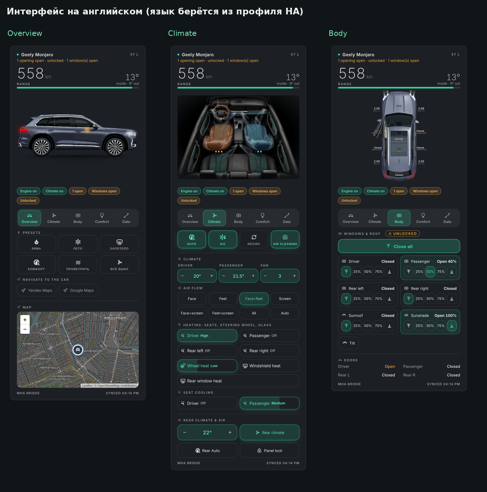

## 12. Готовые конфигурации

### Телефон: всё на вкладках

```yaml
type: custom:mha-card
name: Monjaro
car_color: "#1f4e9c"
wheels: type3
chrome_delete:
  rails: body
  doors: body
  windows: 0.6
arch_color: black
default_tab: overview
presets:
  winter: { name: Прогрев, icon: mdi:snowflake-melt, temp: 25 }
  defog: false
  parking: { name: Парковка, icon: mdi:car-brake-parking, windows: closed, sunroof: closed, ac: false }
nav: [yandex, maps]
tank_size: 60
```

### Настенный планшет: панель на весь экран

```yaml
type: custom:mha-card-panel
car_color: "#e9ebee"
wheels: type5
cabin_fabric: light_gray
cabin_trim: silver
default_tab: climate
nav: [yandex]
nav_mode: locate
```

### Минимум: строка на главный дашборд

```yaml
type: custom:mha-card-mini
buttons: [auto, ac, defrost]
hide_name: true
```

### Вид сверху для правого руля

```yaml
type: custom:mha-card
view: top
rhd: true
car_color: "#16181c"
top_labels: [doors, windows, tires]
car_3d: true
```

## 13. Демо-режим — `demo`

Ключ `demo: true` включает карточку без связи с машиной: она показывает встроенную модель Monjaro, и **все кнопки работают** — климат, подогрев и вентиляция сидений, окна, люк, шторка, атмосферная подсветка, пресеты (в том числе ваши, с любыми ключами и `actions`). Нажали «Зима» — температура стала 24°, включился обогрев стекла, а на салонной картинке поменялись потоки воздуха. В машину и в Home Assistant ничего не отправляется, реальные сущности не читаются.

```yaml
type: custom:mha-card
demo: true            # убрать или поставить false, когда захотите вернуть реальные данные
car_image: monjaro
presets:
  winter: { temp: 24 }
```

- Работает во всех карточках: `mha-card`, `-full`, `-compact`, `-mini`, `-panel`.
- Состояние модели общее для всех демо-карточек на странице (нажали в одной — изменилось во всех) и сбрасывается при перезагрузке страницы.
- Окна и люк движутся плавно, как на машине; двери, капот, багажник и замок в модели не меняются (их нет в управлении карточки).
- Язык и тема берутся из профиля Home Assistant. В подвале карточки написано «DEMO», чтобы демо нельзя было принять за реальные данные.
- Удобно для настройки: подберите цвет, диски, пресеты, `tabs`, а потом уберите `demo`.

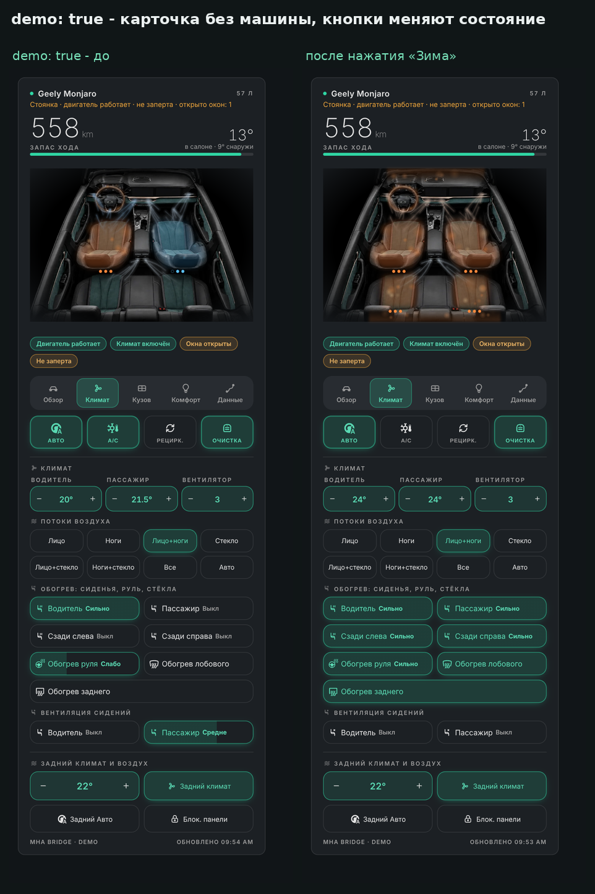
